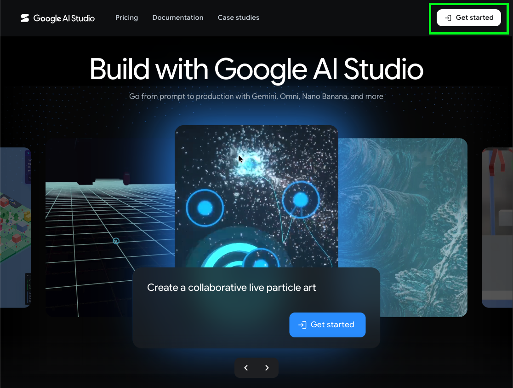
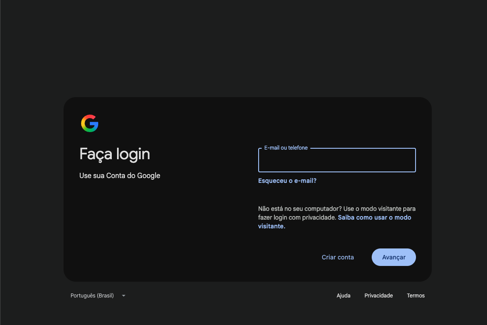
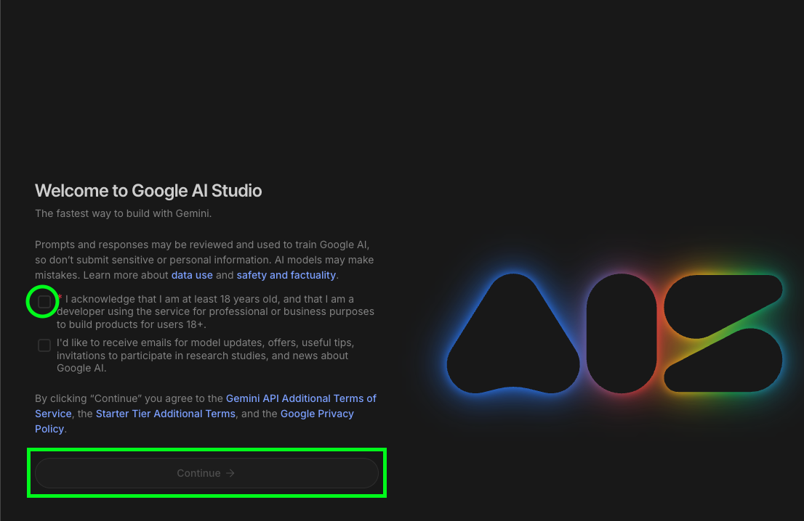
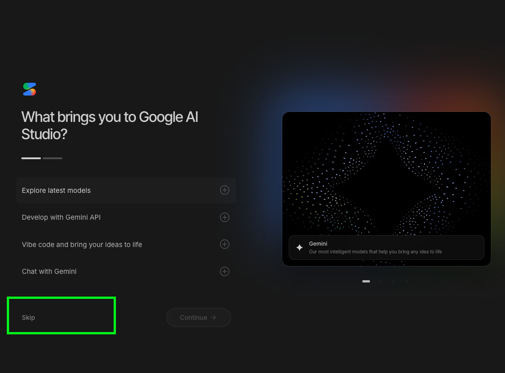
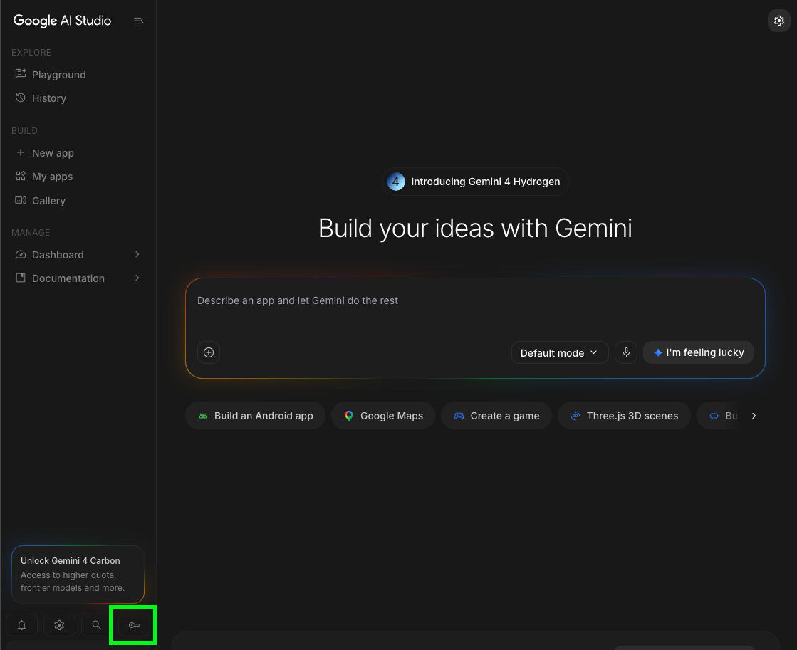
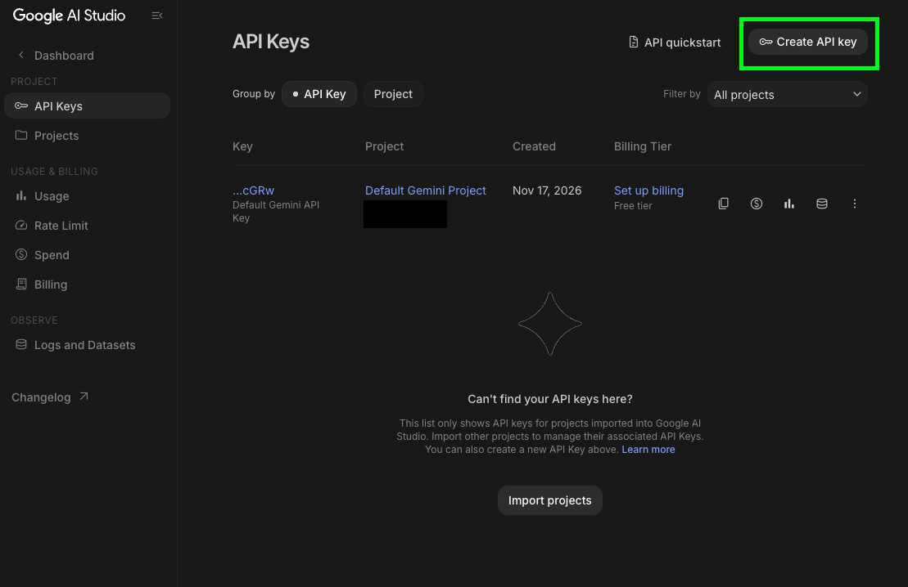
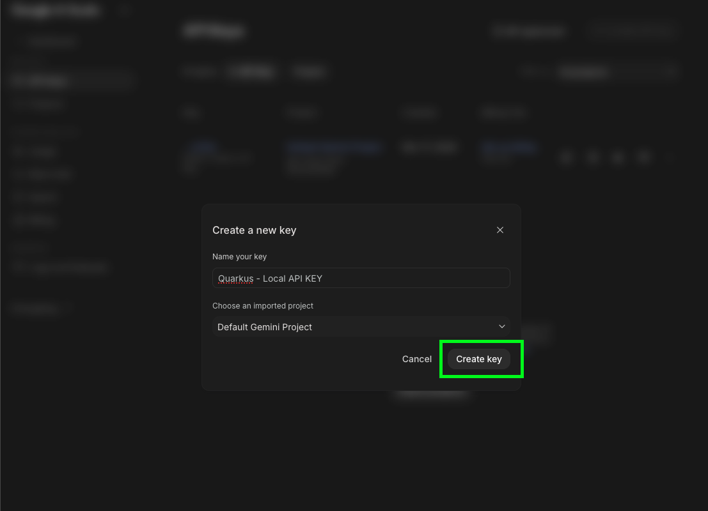
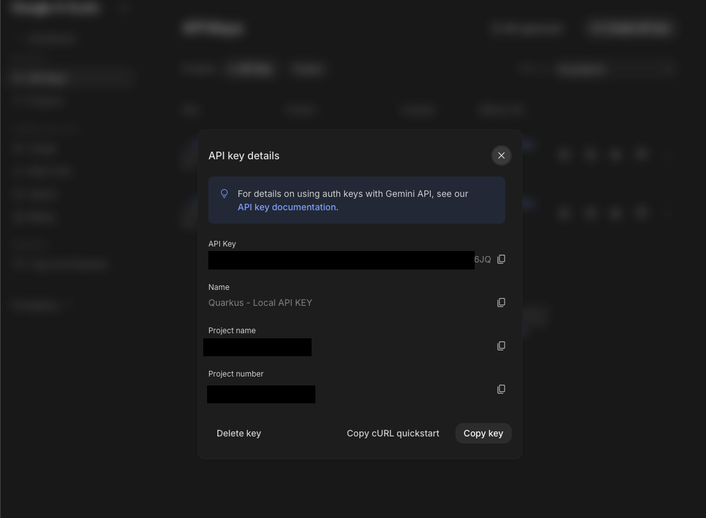

# Como Criar uma API Key no Google AI Studio

**Criador:** Izaque Maciel Cunha

**Propósito:** Este tutorial tem como objetivo guiar desenvolvedores e usuários no processo passo a passo para gerar uma chave de API (API Key) no Google AI Studio. Com essa chave, você poderá autenticar e integrar modelos de inteligência artificial do Google (como o Gemini) em suas próprias aplicações, scripts e projetos.

### Passo 1: Acessar o portal

Acesse o site oficial do Google AI Studio através do link <https://aistudio.google.com>. Na página inicial, clique no botão **"Get started"** localizado no canto superior direito.



### Passo 2: Fazer Login

Você será redirecionado para a tela de autenticação. Faça o login utilizando as credenciais da sua Conta do Google.



### Passo 3: Aceitar os Termos de Serviço

Na tela de boas-vindas, leia as informações sobre o uso de dados e políticas. Marque a caixa de seleção para confirmar que você tem mais de 18 anos e concorda com os termos. Em seguida, clique no botão **"Continue"**.



### Passo 4: Pular a introdução (Opcional)

O sistema perguntará o que traz você ao Google AI Studio ("What brings you to Google AI Studio?"). Você pode explorar as opções ou simplesmente clicar no botão **"Skip"** no canto inferior esquerdo para ir direto ao painel.



### Passo 5: Acessar o menu de API

No painel principal (Dashboard) do Google AI Studio, olhe para o menu de navegação lateral esquerdo. Role até a parte inferior e clique no **ícone de chave** para acessar a seção de chaves de API.



### Passo 6: Iniciar a criação da chave

Na página "API Keys", você verá uma lista (vazia, se for a primeira vez) das suas chaves. Clique no botão **"Create API key"** no canto superior direito da tela.



### Passo 7: Configurar e Gerar a Chave

Uma janela modal chamada "Create a new key" aparecerá.

1. No campo **"Name your key"**, digite um nome descritivo para a sua chave (por exemplo, "Quarkus - Local API KEY").
2. No campo **"Choose an imported project"**, você pode manter o projeto padrão do Gemini.
3. Clique no botão **"Create key"** para finalizar.



### Passo 8: Copiar a API Key

Pronto! A janela de detalhes da sua nova API Key será exibida. Clique no botão **"Copy key"** para copiá-la para a sua área de transferência. Guarde esta chave em um local seguro (como variáveis de ambiente no seu projeto) e nunca a exponha publicamente em repositórios de código.



### ⚠️ Aviso Importante (Disclaimer)

Por se tratar da utilização da camada gratuita (Free Tier) da API do Gemini, há limites de requisições e a infraestrutura é compartilhada. Durante picos de uso da plataforma, você pode ocasionalmente se deparar com a seguinte mensagem de erro na sua aplicação:

```json
{
  "error": {
    "code": 503,
    "message": "This model is currently experiencing high demand. Spikes in demand are usually temporary. Please try again later.",
    "status": "UNAVAILABLE"
  }
}
```

Isso é um comportamento normal para o plano gratuito em momentos de alta demanda global. Caso encontre este erro, a recomendação é implementar uma estratégia de *retry* (tentativa) no seu código após alguns segundos ou aguardar um pouco antes de tentar realizar a requisição novamente.